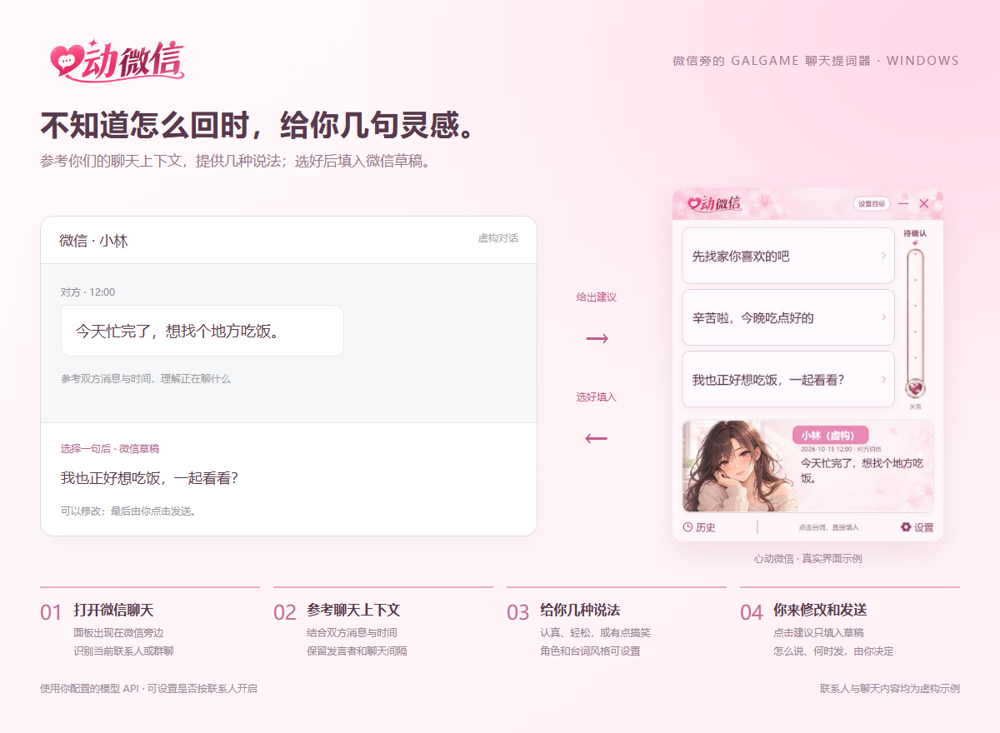
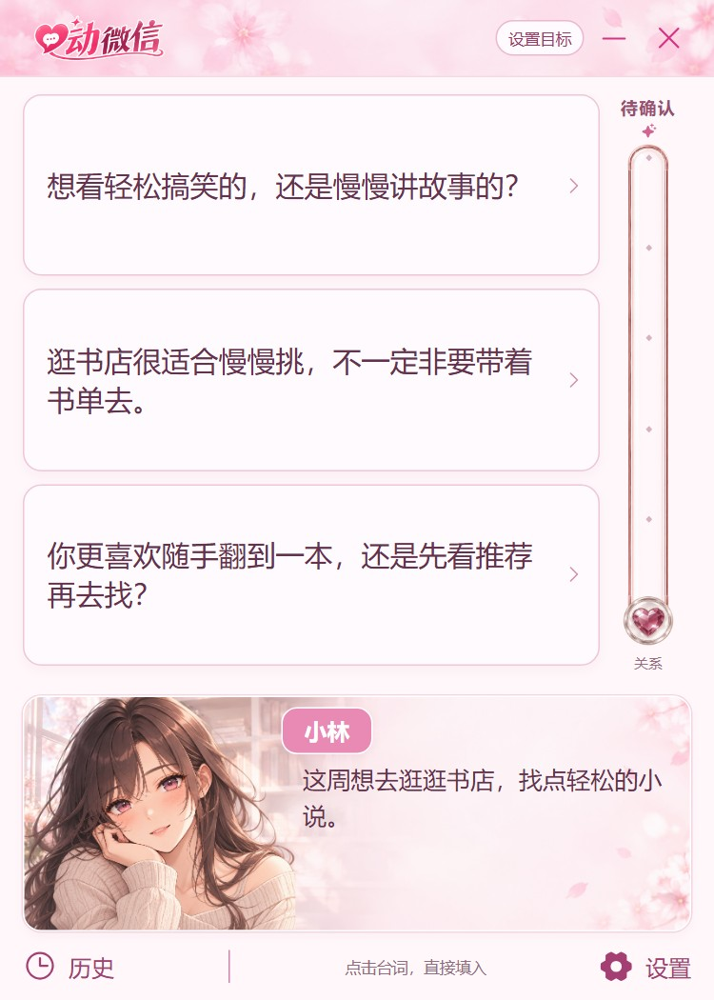
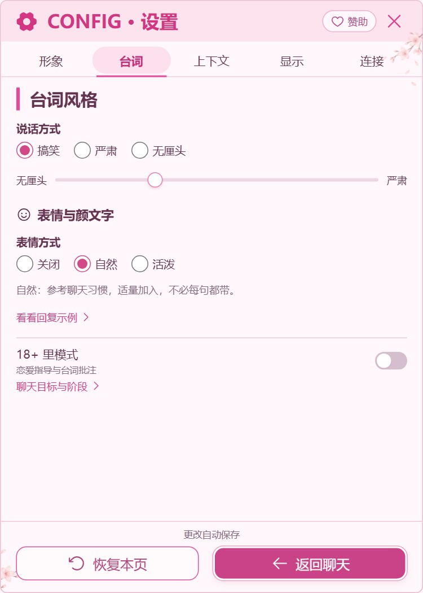
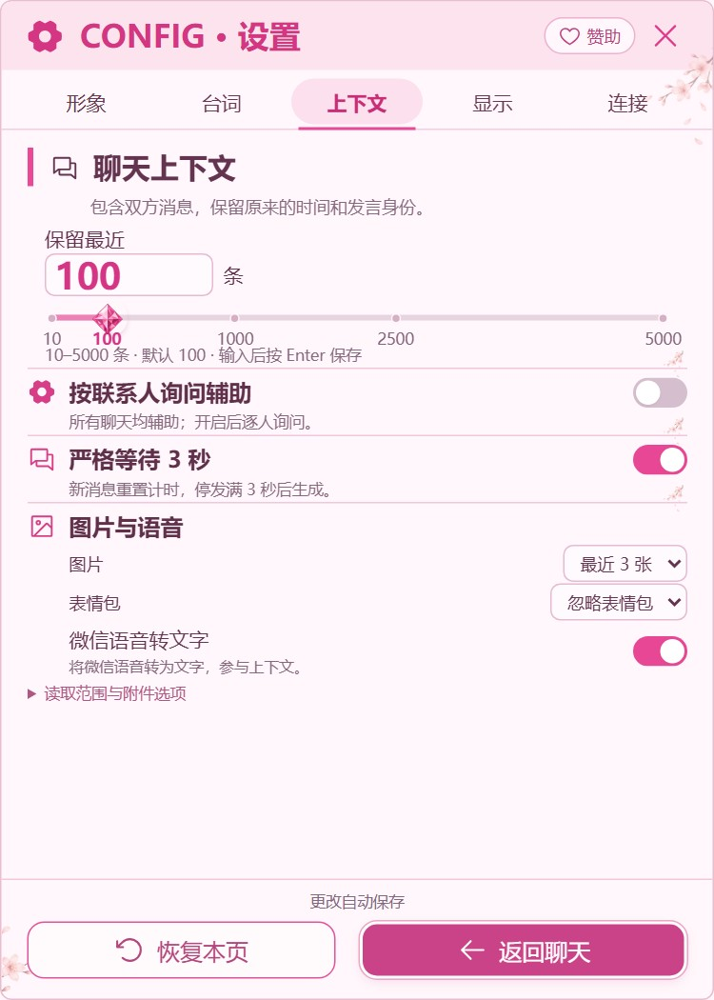

<p align="center">
  
</p>

<h1 align="center">心动微信 ♥</h1>

<p align="center"><strong>把心动，写进下一句。</strong><br>微信旁的 Galgame 聊天提词器，给正在犹豫的你一点回复灵感。</p>

<p align="center">
  
  
  
</p>

<p align="center">
  <a href="https://github.com/georgehuang000/heartbeat-wechat/releases">下载安装包</a> ·
  <a href="#features">功能图解</a> ·
  <a href="#quick-start">快速开始</a> ·
  <a href="https://82.157.178.52/heartbeat-wechat/">官网演示</a> ·
  <a href="#sponsor">支持作者</a>
</p>

## 它是做什么的？

对方发来一句话，想认真回，却不知道怎么说；想接个梗，又怕用力过猛。

**心动微信**会在微信旁边显示一个粉色对话框，参考你们双方的聊天上下文，给出几句不同方向的回复。像玩 Galgame 一样选一句，然后改成自己的话。

**点击建议只填入微信草稿，最后由你确认发送。** 你也可以不选，让一轮聊天自然结束。



<a id="features"></a>

## 功能图解

下面是当前 Windows 桌面界面的演示截图。联系人「小林」与聊天内容均为虚构，不含真实微信记录。

<table>
  <tr>
    <td width="50%" valign="top">
      <h3>💬 像 Galgame 一样选台词</h3>
      <p>收到消息，看看几种不同的说法。<br>选中填入草稿，修改和发送由你决定。</p>
      
    </td>
    <td width="50%" valign="top">
      <h3>🌸 给对方选个虚拟形象</h3>
      <p>16 个年龄与性别预设，另有默认形象。<br>搭配三种场景，外观和台词分别设置。</p>
      
    </td>
  </tr>
  <tr>
    <td width="50%" valign="top">
      <h3>🎭 认真一点，还是搞笑一点？</h3>
      <p>搞笑、严肃、无厘头，加上语气滑块。<br>表情与颜文字随你调，也能查看示例。</p>
      
    </td>
    <td width="50%" valign="top">
      <h3>🕒 上下文与节奏，自己掌握</h3>
      <p>默认 100 条，精确设置 10–5000 条。<br>按人开启、等待和媒体设置，都在这里。</p>
      
    </td>
  </tr>
</table>

### 还有这些

| 功能 | 如何帮助聊天 |
| --- | --- |
| 单聊与群聊 | 显示联系人备注或群名称，群成员分别标注发言身份。 |
| 双方上下文 | 保留谁说了什么、原时间与相邻消息间隔，参考最近的话题。 |
| 更新节奏 | 严格等待 3 秒可关闭；新建议准备好前保留旧选项。 |
| 按联系人开启 | 可先询问是否为这个人开启，记住选择；关闭询问时所有聊天可辅助。 |
| 图片与表情包 | 将可用图片交给所选多模态模型；无法读取时保留缺失状态。 |
| 微信语音转文字 | 优先使用微信原生转写，成功取得的文本参与上下文。 |
| API 连接 | 支持 Chat Completions、Responses、Messages 协议；使用自己配置的服务，不在本地运行大模型。 |
| 后台暂停 | 切到其他应用后暂停自动操作，回到微信或心动微信再继续。 |

历史读取条数与实际模型输入预算不同，设置 5000 条不等于每次将 5000 条完整上传。角色只是外观预设，不代表对方的真实年龄，也不会自动推进关系。

<a id="quick-start"></a>

## 快速开始

1. **下载安装**：打开 [GitHub Releases](https://github.com/georgehuang000/heartbeat-wechat/releases)，选择 Windows x64 安装包。
2. **连接你的模型**：在「设置 → 连接」选择协议，填写 API 地址、模型名与密钥。调用费用按服务商规则计算。
3. **打开微信聊天**：面板跟随微信，参考当前聊天；可以在「上下文」里设置只为指定联系人辅助。
4. **选一句，再自己发送**：点选项填入草稿，在微信里修改、确认后发送。

当前为 **Windows 桌面预览版**，适配以已验证的微信 **4.1.13.65** 为主；其他版本需要单独验证。系统与安装说明见对应 Release，详细边界见[使用说明](docs/public/README.md)。

## 常见问题

**会替我自动发送消息吗？**

不会。点击建议只填入草稿，发送由你自己决定。

**必须是暧昧或恋爱聊天才能用吗？**

不必。日常聊天、朋友间接梗、群聊接话都可以；「18+ 里模式」是恋爱指导与台词批注的玩笑标签，需先确认成年关系场景。

**聊天记录会发到哪里？**

本地设置与缓存留在电脑。生成回复时，会按你的设置把选定上下文及可用附件发送给你配置的模型服务商；API 密钥通过 Windows DPAPI 保存。

**所有图片、语音、链接都能看懂吗？**

图片取决于本地资源是否可用及模型能力；语音需成功取得转写。链接目前只参考卡片预览，网页正文计划在第二期。缺失内容不会被当成已理解，回复也可能误判事实或发言归属。

<a id="development"></a>

## 开发与反馈

遇到问题或有新点子，欢迎提交 [Issue](https://github.com/georgehuang000/heartbeat-wechat/issues)。请描述微信版本、操作步骤和现象，截图前遮去真实联系人、消息与密钥。

<details>
<summary>从源码运行与构建</summary>

需要 Windows x64、Python 3.12、Node.js、Microsoft WebView2，以及你自己的模型 API。优先使用独立 Conda 环境，不在 base 安装。

在独立 Python 3.12 环境创建项目虚拟环境，然后执行：

```powershell
python -m venv .venv
.venv/Scripts/python.exe -m pip install -r requirements-reader.txt
.venv/Scripts/python.exe scripts/prepare_reader.py
npm --prefix prototype-heart-wechat ci
npm --prefix prototype-heart-wechat run build
.venv/Scripts/python.exe main.py
```

`prepare_reader.py` 获取并校验固定版本读取依赖，不读取微信。本项目不是腾讯官方接口。

只看虚构界面：在 `prototype-heart-wechat` 中运行 `npm run dev`，不连接真实微信或模型。

构建 Windows 单文件：安装 `requirements-build.txt`，构建前端后，用 PyInstaller 执行 `packaging/heart-wechat.spec`；环境变量 `GALCHAT_BUNDLE_MODE=onefile` 指定单文件模式。

源码仓库不包含聊天记录、数据库缓存、个人密钥、调试截图与本地运行环境。开发数据位于 `data/`，打包版默认使用 `%LOCALAPPDATA%/HeartWeChat`。

[项目结构与当前限制](docs/public/README.md) · [公开上传检查](docs/public/PRIVACY-CHECK.md)

</details>

<a id="sponsor"></a>

## 支持作者

如果这个小工具帮到了你，欢迎点个 Star，或者请作者喝杯奶茶 ♥

**直接使用支付宝扫描下方收款码即可，无需跳转网站。** 赞助完全自愿，不影响任何功能。

<p align="center">
  
</p>

<p align="center">谢谢你，让这个小小的粉色对话框继续变好。</p>

---

第三方组件与图像遵循各自许可，许可文本保留于对应目录及 `packaging/THIRD-PARTY-NOTICES.txt`；项目尚未指定整体开源许可证。
